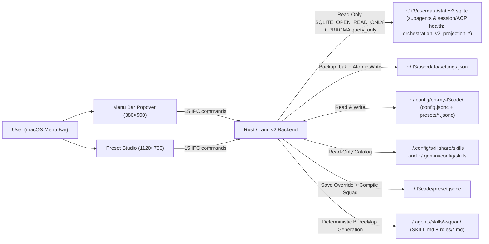

<div align="center">
  
  <h1>oh-my-t3code</h1>
  <p><strong>Native macOS Companion, Preset Studio, and Deterministic Squad Compiler for T3 Code</strong></p>
  <p>Inspired by <code>oh-my-opencode-slim</code> and <code>oh-my-opencode-companion</code>.</p>
</div>

<p align="center">🌐 <strong>English</strong> | <a href="README.pt-BR.md">Português (Brasil)</a></p>

**Oh My T3Code** adds global declarative presets, per-project overrides, and deterministic squad compilation to **T3 Code** (`~/.t3`), without modifying the T3 Code binary or database.

Built with **Tauri v2 (Rust)** on the backend and **React 19 + TypeScript + Tailwind CSS v4** for the UI, the app runs quietly in the macOS menu bar (`ActivationPolicy::Accessory`) and syncs models, accounts, and agent playbooks in seconds.

## What `oh-my-t3code` is

`oh-my-t3code` solves four recurring pain points when running multiple agents and repositories in T3 Code:

- **Centralized Global Presets**: define a default preset in `~/.config/oh-my-t3code/presets/*.jsonc` to apply the same orchestrator (`defaultModelSelection`) and fallback (`fallbackModelSelection`) across every project without a local override
- **Per-repository overrides with inheritance (`extends`)**: customize only what changes for a specific project through `<repo>/.t3code/preset.jsonc` while inheriting cleanly from a global preset
- **One-click instance swap (`⇄`) and deterministic compilation**: switch between configured provider instances in T3 Code (such as primary and secondary accounts like `antigravity` ⇄ `antigravity_2`) or configured models (such as `codex` models `gpt-6.1-sol` ⇄ `gpt-6.1-terra`) when rate limits hit, and compile `.agents/skills/<slug>-squad/{SKILL.md, roles/*.md}` with a Unified Diff preview before writing to disk
- **Intelligent Session, Concurrency & Health Management (`sessionPolicy`)**:
  - **Hardware profiles (`laptop-8gb`, `desktop-16gb`, `desktop-32gb-plus`)**: automatically downgrades `parentThinkingLevel` to `medium` on `laptop-8gb`, never emitting `high` or `xhigh` for the orchestrator in `settings.json` or `SKILL.md`
  - **Deterministic Section 5 rules in `SKILL.md`**: compiles `## 5. Gestão de sessão e concorrência (oh-my-t3code)` with Antigravity/total worker concurrency caps, per-task-kind worker thinking (`workerThinkingByKind`), and preventive handoff thresholds
  - **Real-time health monitoring in the Menu Bar Popover**: surfaces live session health badges (`OK`, `Pai gordo`, `ACP morto`, `Muitos workers`, and `Alerta de RAM (8 GB)`) alongside the **`Abrir thread pai novo`** handoff copy button, without writing to `statev2.sqlite` or restarting T3 Code processes

## Architecture overview

The diagram below shows how the UI, the Rust/Tauri v2 backend, local T3 Code files, and the target repository read and write data:



## Prerequisites

Check your environment before running or packaging the native macOS app:

- **macOS**: primary target OS for the native MVP (configured with `ActivationPolicy::Accessory` and `macOSPrivateApi` in `src-tauri/tauri.conf.json`)
- **Bun**: project package manager and script runner (`bun.lock`, `bun run <script>`)
- **Rust & Cargo (Edition 2021)** and **Xcode Command Line Tools** (`xcode-select --install`): required to compile and run the Tauri v2 backend (`src-tauri/Cargo.toml`)
- **T3 Code (`~/.t3`)**: installed and initialized with configured projects and providers. Required for live data in production, optional if you want to test the UI in Browser Preview mode with `MockIpcStore`

## Install prebuilt macOS app (no Apple Developer fee)

Builds are packaged as a Universal macOS `.dmg` (Apple Silicon + Intel) with ad-hoc code signing (`"signingIdentity": "-"` in `src-tauri/tauri.conf.json`). Because the app is not notarized with a paid Apple Developer ID certificate, macOS adds a browser quarantine attribute (`com.apple.quarantine`) on manual downloads.

### Option A: One-command installer (`curl`)

Downloads the latest Universal `.dmg` from GitHub Releases, installs `Oh My T3Code.app` into `/Applications`, and clears `com.apple.quarantine` automatically:

```bash
curl -fsSL https://raw.githubusercontent.com/alencarfreire/oh-my-t3code/main/install.sh | bash
```

To install a specific release tag (or run locally from a clone):

```bash
curl -fsSL https://raw.githubusercontent.com/alencarfreire/oh-my-t3code/main/install.sh | bash -s -- v0.2.0
# or from a local clone: ./install.sh v0.2.0
```

### Option B: Homebrew Cask

```bash
brew tap alencarfreire/oh-my-t3code https://github.com/alencarfreire/oh-my-t3code.git
brew trust alencarfreire/oh-my-t3code
brew install --cask alencarfreire/oh-my-t3code/oh-my-t3code
```

The cask (`Casks/oh-my-t3code.rb`) includes a `postflight_steps` rule that automatically runs `xattr -dr com.apple.quarantine` on `/Applications/Oh My T3Code.app`.

### Option C: Manual `.dmg` download

1. Download `Oh.My.T3Code_<version>_universal.dmg` from [GitHub Releases](https://github.com/alencarfreire/oh-my-t3code/releases) and drag `Oh My T3Code.app` to `Applications`.
2. Clear the quarantine flag once:

```bash
xattr -dr com.apple.quarantine "/Applications/Oh My T3Code.app"
```

*(Or attempt to open the app once, dismiss the prompt, and click **Open Anyway** in **System Settings → Privacy & Security**.)*

## Installation and quick start (build from source)

Clone the repository and install frontend dependencies with Bun:

```bash
git clone https://github.com/alencarfreire/oh-my-t3code.git oh-my-t3code
cd oh-my-t3code
bun install
```

After installing dependencies, pick the run mode that fits your workflow.

### Option 1: Native macOS app mode (development)

Start the Vite dev server on port `1420` and launch the native Tauri v2 app in accessory mode:

```bash
bun run tauri:dev
```

The app launches without a Dock icon and adds the `oh-my-t3code` icon to the macOS menu bar. Left-click the icon to open the **Popover**, or right-click it to open the context menu (`Alternar Popover` to toggle the popover, `Abrir Preset Studio` to open Preset Studio, and `Sair` to quit).

### Option 2: Build the macOS `.app` and `.dmg` installer

Compile the frontend (`tsc -b && vite build`), build the Rust release binary, and package the macOS bundle:

```bash
bun run tauri:build
```

Once the build finishes, find the output artifacts inside `src-tauri/target/release/bundle/`, including the `.app` bundle under `macos/` and the `.dmg` installer image under `dmg/`.

### Option 3: Browser preview mode (no T3 Code or Rust required)

Start only the web UI through Vite on port `1420` (`strictPort: true`), which activates the in-memory `MockIpcStore` automatically:

```bash
bun run dev
```

When opened outside the Tauri runtime at `http://localhost:1420`, the app displays the `Browser Preview (Mock IPC ativo)` top bar to switch between `Popover (380×500)` and `Preset Studio (1120×760)` using in-memory sample projects. You can also open either window directly at `http://localhost:1420/?view=popover` and `http://localhost:1420/?view=studio` (with optional `projectId` and `presetId` query parameters in Studio).

## 5-minute quickstart

On the first boot of the native backend (or when loading the in-memory mock), `ensure_seed_presets` initializes `~/.config/oh-my-t3code/config.jsonc` with `activeGlobalPresetId: "default"` and `enabled: true`, and provisions the **`default` (`Default (OMOS Standard)`)** preset in `~/.config/oh-my-t3code/presets/`:

- **`default` (`Default (OMOS Standard)`)**: default installation preset pre-configured with the 5 canonical `oh-my-opencode-slim` roles (`explorer`, `oracle`, `designer`, `fixer`, and `qa-reviewer`) on the universal `codex` provider (`gpt-6.1-sol` for the orchestrator, `oracle`, and `fixer`; `gpt-6-luna` for `explorer` and `designer`; `gpt-6-astra` for `qa-reviewer`).

From there, you can create your own global presets in **Preset Studio** (**`+ Novo Preset Global`**) and per-project overrides using any providers and models configured in your T3 Code environment. Follow these steps for your daily workflow:

1. **Set the Global Preset**: open the **Popover** from the menu bar, select `default` or a custom preset under **Preset Global Default**, and confirm the toggle is set to **Ativo** (Active).
2. **Add an override only where needed**: projects without an override follow the Global Default automatically and stay hidden from the main list; click **`+ Configurar Projeto`** (Configure Project) to create a local override on a specific repository.
3. **Use the one-click swap (`⇄`) when quota tightens**: click the instance/model pill on the global card or a project card to switch between configured provider instances (such as primary ⇄ secondary instances like `antigravity` ⇄ `antigravity_2`) or toggle between configured models (such as `gpt-6.1-sol` ⇄ `gpt-6.1-terra` on `codex`) in one click.
4. **Customize in Preset Studio (`⌘,`)**: press `⌘,` (or click **Studio**) to create global presets (`+ Novo Preset Global`), edit roles, fallback chains, optional skills, MCPs, and contention rules, then inspect the Unified Diff before writing to disk.

## Documentation map

Read the detailed guides for UI workflows, JSONC syntax, and internal architecture:

- [Complete User Guide (Popover & Preset Studio)](docs/en/USER_GUIDE.md): step-by-step walkthrough of every screen, button, badge, tab, and daily workflow
- [JSONC Presets, Inheritance & Compiler Reference](docs/en/JSONC_PRESETS_REFERENCE.md): complete preset schema, `extends` resolution, option normalization, and compiled output format
- [Architecture, Security, IPC & Troubleshooting](docs/en/ARCHITECTURE_AND_TROUBLESHOOTING.md): Rust module breakdown, all 15 IPC commands, and common error diagnostics
- [State Machines & Invariants (pt-BR)](docs/STATE_MACHINES.md): formal catalog of states, transitions, and invariants across the UI, Rust backend, and files on disk

## Security and safety guarantees

Every read and write operation enforces four strict architectural invariants:

- **Strictly read-only `statev2.sqlite` access**: the backend opens `~/.t3/userdata/statev2.sqlite` exclusively with `SQLITE_OPEN_READ_ONLY | SQLITE_OPEN_NO_MUTEX` and `PRAGMA query_only = true` for reading projects, subagents, and session/ACP health (`orchestration_v2_projection_*`), preventing write locks and any risk of corrupting T3 Code state—without ever writing to the database, creating threads, or terminating `agy_acp_server` processes
- **Mandatory backup and atomic writes to `settings.json`**: before writing any change to `~/.t3/userdata/settings.json`, the backend writes a backup to `~/.t3/userdata/settings.json.bak` and persists the new version through a unique temporary file + `sync_all()` + `rename`, preserving 100% of unrelated keys
- **Deterministic, cache-safe compilation**: `<repo>/.agents/skills/<slug>-squad/SKILL.md` and `roles/*.md` are generated in deterministic `BTreeMap` order with no random timestamps or ephemeral UUIDs, and Studio requires a Unified Diff preview before saving
- **Strict IPC contract parity**: all 15 Tauri commands exposed in `src-tauri/src/lib.rs` mirror their exact names, arguments, and return types in `src/types/ipc.ts` (`IPC_COMMANDS`)

## Verification commands

Run this suite whenever you change Rust or TypeScript code to verify types, compilation, and unit tests:

```bash
cargo check --manifest-path src-tauri/Cargo.toml
cargo test --manifest-path src-tauri/Cargo.toml
bun run typecheck
bun run test
bun run build
```
