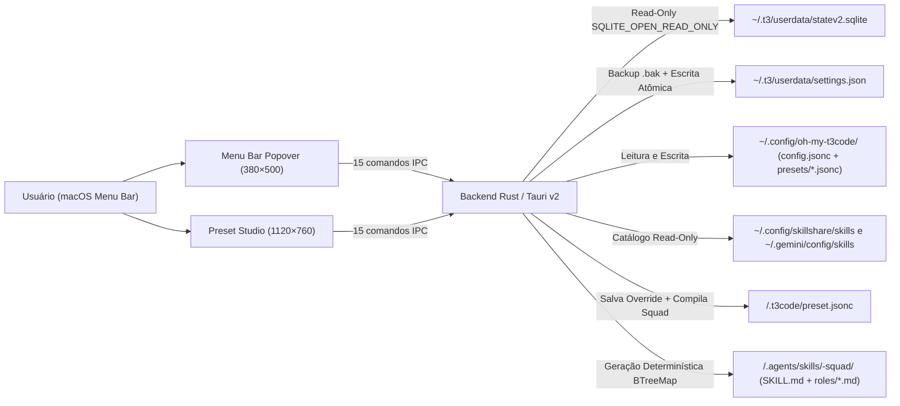

<div align="center">
  
  <h1>oh-my-t3code</h1>
  <p><strong>Companion nativo para macOS, Preset Studio e Compiler determinístico de squads para o T3 Code</strong></p>
  <p>Inspirado no <code>oh-my-opencode-slim</code> e no <code>oh-my-opencode-companion</code>.</p>
</div>

**Oh My T3Code** adiciona presets declarativos globais, overrides por projeto e compilação determinística de squads ao **T3 Code** (`~/.t3`), sem alterar o binário nem o banco de dados do T3 Code.

Construído com **Tauri v2 (Rust)** no backend e **React 19 + TypeScript + Tailwind CSS v4** na interface, o aplicativo opera discretamente na barra de menus do macOS (`ActivationPolicy::Accessory`) e sincroniza modelos, contas e playbooks de agentes em segundos.

## O que é o oh-my-t3code

O `oh-my-t3code` resolve três dores recorrentes no uso diário de múltiplos agentes e projetos no T3 Code:

- **Gestão centralizada de Presets Globais**: defina um preset padrão em `~/.config/oh-my-t3code/presets/*.jsonc` para aplicar o mesmo orquestrador (`defaultModelSelection`) e fallback (`fallbackModelSelection`) em todos os projetos sem override.
- **Overrides por repositório com herança (`extends`)**: personalize apenas o que muda em um projeto específico via `<repo>/.t3code/preset.jsonc`, mantendo herança limpa de um preset global.
- **Swap de instância em 1 clique (`⇄`) e compilação determinística**: alterne instantaneamente entre contas (`Agy Veca` `antigravity` ⇄ `Agy Principal` `antigravity_2`) ou modelos Codex (`gpt-6.1-sol` ⇄ `gpt-6.1-terra`) quando a cota aperta, e compile `.agents/skills/<slug>-squad/{SKILL.md, roles/*.md}` com preview de Unified Diff antes de gravar.

## Visão geral da arquitetura

O diagrama abaixo mostra o fluxo de leitura e escrita entre a interface, o backend Rust/Tauri v2, os arquivos locais do T3 Code e o repositório alvo:



## Pré-requisitos

Verifique o ambiente antes de rodar ou empacotar o aplicativo nativo:

- **macOS**: sistema operacional alvo principal do MVP nativo (configurado com `ActivationPolicy::Accessory` e `macOSPrivateApi` em `src-tauri/tauri.conf.json`).
- **Bun**: gerenciador de pacotes e executor de scripts do projeto (`bun.lock`, `bun run ...`).
- **Rust & Cargo (Edition 2021)** e **Xcode Command Line Tools** (`xcode-select --install`): obrigatórios para compilar e executar o backend Tauri v2 (`src-tauri/Cargo.toml`).
- **T3 Code (`~/.t3`)**: instalado e inicializado com projetos e provedores configurados. É obrigatório para dados reais em produção, mas opcional se você quiser testar apenas a interface no modo Browser Preview com `MockIpcStore`.

## Instalação e execução rápida

Clone o repositório e instale as dependências de frontend com o Bun:

```bash
git clone <url-do-repositorio> oh-my-t3code
cd oh-my-t3code
bun install
```

Depois de instalar as dependências, escolha o modo de execução adequado ao seu objetivo.

### Opção 1: Modo App Nativo macOS (Desenvolvimento)

Inicia o servidor Vite na porta `1420` e abre o aplicativo nativo Tauri v2 em modo acessório:

```bash
bun run tauri:dev
```

O aplicativo sobe sem ícone no Dock e adiciona o ícone do `oh-my-t3code` na barra de menus superior do macOS. Clique com o botão esquerdo no ícone para abrir o **Popover** ou com o botão direito para abrir o menu de contexto (`Alternar Popover`, `Abrir Preset Studio`, `Sair`).

### Opção 2: Gerar executável e instalador macOS (`.app` e `.dmg`)

Compila o frontend (`tsc -b && vite build`), o binário Rust em release e empacota o aplicativo macOS:

```bash
bun run tauri:build
```

Ao final do build, os artefatos são gerados dentro de `src-tauri/target/release/bundle/` (incluindo o pacote `.app` em `macos/` e a imagem de instalação em `dmg/`).

### Opção 3: Modo Browser Preview (sem T3 Code e sem compilar Rust)

Inicia apenas a interface web via Vite na porta `1420` (`strictPort: true`), ativando automaticamente o `MockIpcStore` em memória:

```bash
bun run dev
```

Quando aberto fora do runtime Tauri em `http://localhost:1420`, o aplicativo exibe a barra superior `Browser Preview (Mock IPC ativo)` para alternar entre `Popover (380×500)` e `Preset Studio (1120×760)` usando 4 projetos de exemplo em memória (`oh-my-t3code`, `cabrito`, `dashboard-meta` e `landing-page`). Você também pode abrir cada janela diretamente pelas URLs `http://localhost:1420/?view=popover` e `http://localhost:1420/?view=studio` (com suporte opcional aos parâmetros `projectId` e `presetId` no Studio).

## Primeiros passos em 5 minutos

No primeiro boot do backend nativo (ou no carregamento do mock em memória), a rotina `ensure_seed_presets` inicializa `~/.config/oh-my-t3code/config.jsonc` com `activeGlobalPresetId: "default"` e `enabled: true`, além de criar 4 presets seed em `~/.config/oh-my-t3code/presets/`:

- **`default` (`Default (OMOS Standard)`)**: preset padrão de instalação no provedor universal `codex`, com orquestrador, `oracle` e `fixer` em `gpt-6.1-sol`, `explorer` e `designer` em `gpt-6-luna` e `qa-reviewer` em `gpt-6-astra`.
- **`agy-dual` (`Agy Dual (Veca + Principal)`)**: balanceia `antigravity` (`Agy Veca`) e `antigravity_2` (`Agy Principal`) com `gemini-4-hydrogen` e `gemini-4-argon`.
- **`codex-squad` (`Codex Squad (Issue Threads)`)**: usa topologia `issue-thread-orchestrator` no `codex` com `singleTestDb: true` e política de contenção voltada para suítes concorrentes.
- **`hybrid-agy-codex` (`Hybrid (Agy + Codex)`)**: combina `antigravity_2` / `antigravity` para orquestração, `explorer` e `designer` com `codex` (`gpt-6.1-sol`) para `oracle` e `fixer`, usando isolamento `worktree`.

Todos os 4 presets seed trazem os 5 papéis canônicos do `oh-my-opencode-slim` (`explorer`, `oracle`, `designer`, `fixer` e `qa-reviewer`). Para começar a operar no dia a dia:

1. **Defina o Preset Global**: abra o **Popover** na barra de menus, selecione o preset desejado em **Preset Global Default** (por exemplo `agy-dual` ou `default`) e confirme que o toggle está em **Ativo**.
2. **Adicione um Override apenas onde precisar**: projetos sem override seguem o Global Default automaticamente e ficam ocultos da lista principal; clique em **+ Configurar Projeto** para criar um override em um repositório específico.
3. **Use o Swap rápido (`⇄`) quando a cota apertar**: clique no pill de instância/modelo no card global ou no card do projeto para inverter `Agy Veca` ⇄ `Agy Principal` (ou alternar `gpt-6.1-sol` ⇄ `gpt-6.1-terra` no Codex) em 1 clique.
4. **Personalize no Preset Studio (`⌘,`)**: pressione `⌘,` (ou clique em **Studio**) para editar papéis, cadeias de fallback, skills, MCPs, regras de contenção e revisar o Unified Diff antes de gravar no disco.

## Mapa da documentação

Consulte os guias detalhados para operação da UI, sintaxe JSONC e arquitetura interna:

- [Guia Completo de Uso (Popover & Preset Studio)](docs/GUIA_DE_USO.md): passo a passo visual de todas as telas, botões, badges, abas e fluxos diários.
- [Referência Técnica de Presets JSONC, Herança & Compiler](docs/REFERENCIA_PRESETS_JSONC.md): esquema completo de presets, resolução de `extends`, normalização de opções e formato dos arquivos compilados.
- [Arquitetura, Segurança, IPC & Solução de Problemas (FAQ)](docs/ARQUITETURA_E_TROUBLESHOOTING.md): detalhes dos módulos Rust, mapa dos 15 comandos IPC e diagnóstico de erros comuns.
- [Máquinas de Estado & Invariantes (Técnico)](docs/STATE_MACHINES.md): catálogo formal de estados, transições e invariantes entre UI, Rust e arquivos em disco.

## Segurança e garantias

Todas as operações de leitura e gravação obedecem a quatro invariantes arquiteturais estritas:

- **Acesso estritamente Read-Only ao `statev2.sqlite`**: `~/.t3/userdata/statev2.sqlite` é aberto exclusivamente com as flags `SQLITE_OPEN_READ_ONLY | SQLITE_OPEN_NO_MUTEX` e `PRAGMA query_only = true`, eliminando locks de escrita e qualquer risco de corrupção do estado do T3 Code.
- **Backup obrigatório e escrita atômica em `settings.json`**: antes de gravar qualquer alteração em `~/.t3/userdata/settings.json`, o backend gera um backup em `~/.t3/userdata/settings.json.bak` e grava a nova versão via arquivo temporário único + `sync_all()` + `rename`, preservando 100% das chaves não relacionadas.
- **Compilação determinística e cache-safe**: `<repo>/.agents/skills/<slug>-squad/SKILL.md` e `roles/*.md` são gerados em ordem determinística com `BTreeMap`, sem timestamps aleatórios ou UUIDs efêmeros, e com preview obrigatório de Unified Diff no Studio antes da gravação.
- **Paridade estrita de contrato IPC**: todos os 15 comandos Tauri expostos em `src-tauri/src/lib.rs` possuem espelhamento exato de nome, argumentos e retorno em `src/types/ipc.ts` (`IPC_COMMANDS`).

## Comandos de verificação

Execute a suíte abaixo sempre que alterar código Rust ou TypeScript para validar tipagem, compilação e testes unitários:

```bash
cargo check --manifest-path src-tauri/Cargo.toml
cargo test --manifest-path src-tauri/Cargo.toml
bun run typecheck
bun run test
bun run build
```
