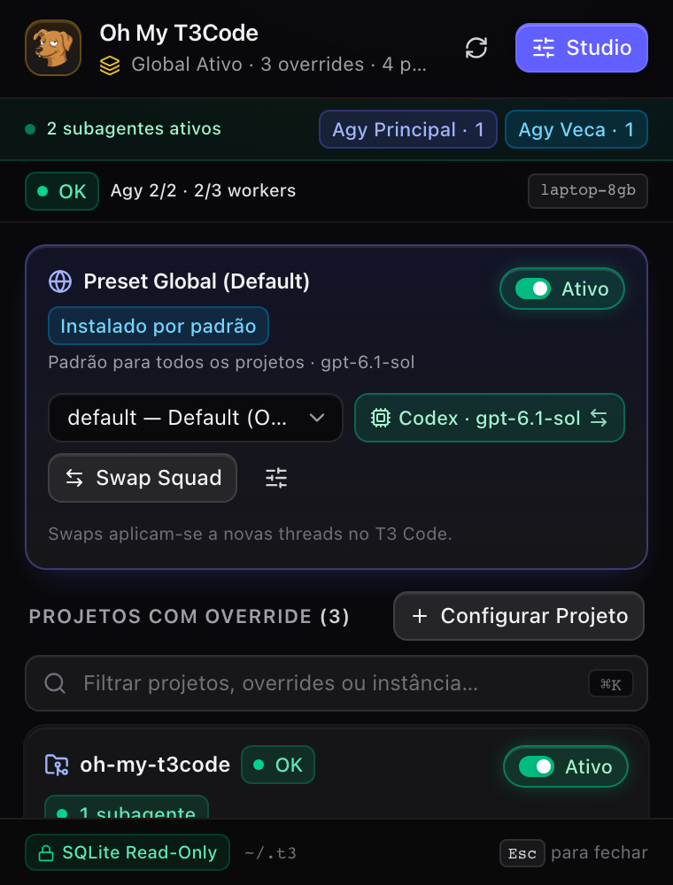
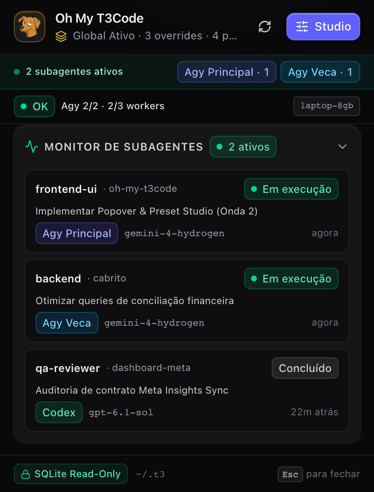
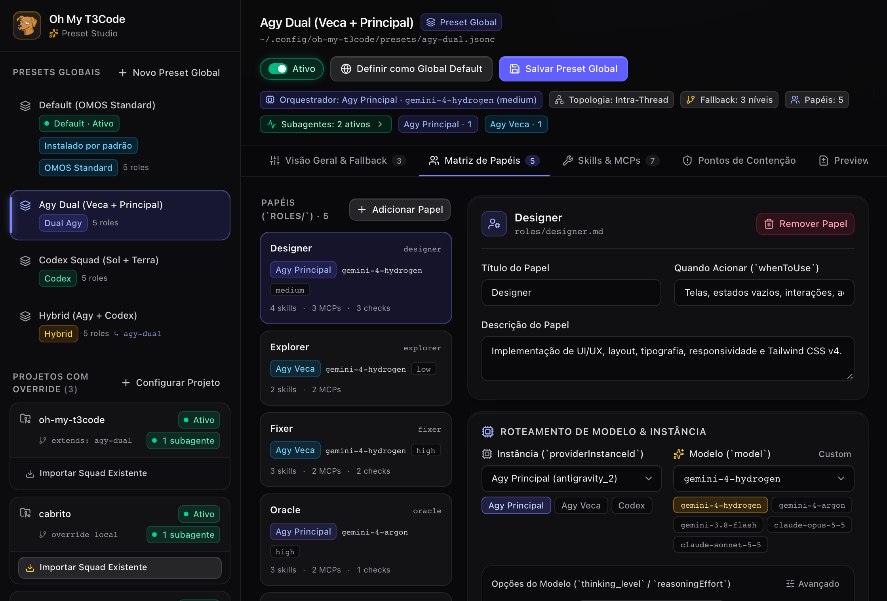
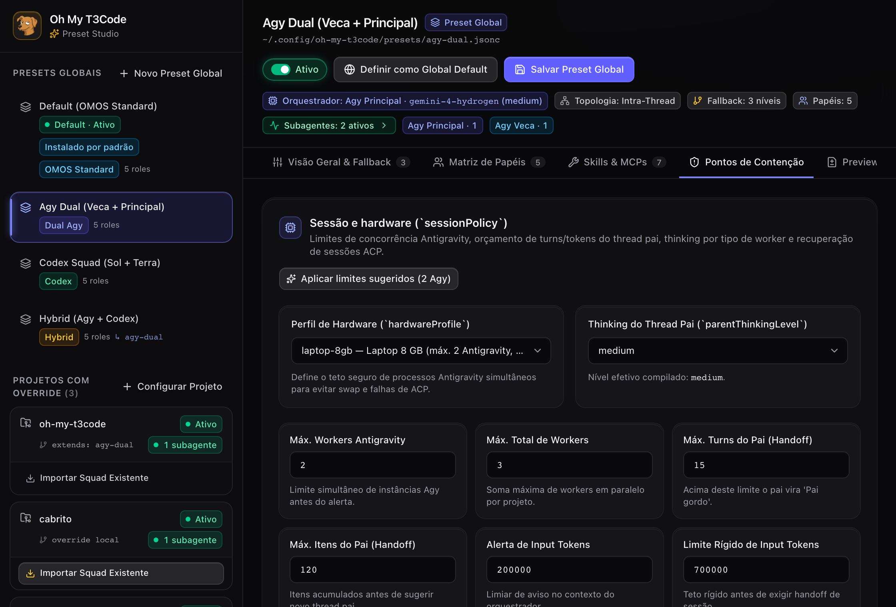
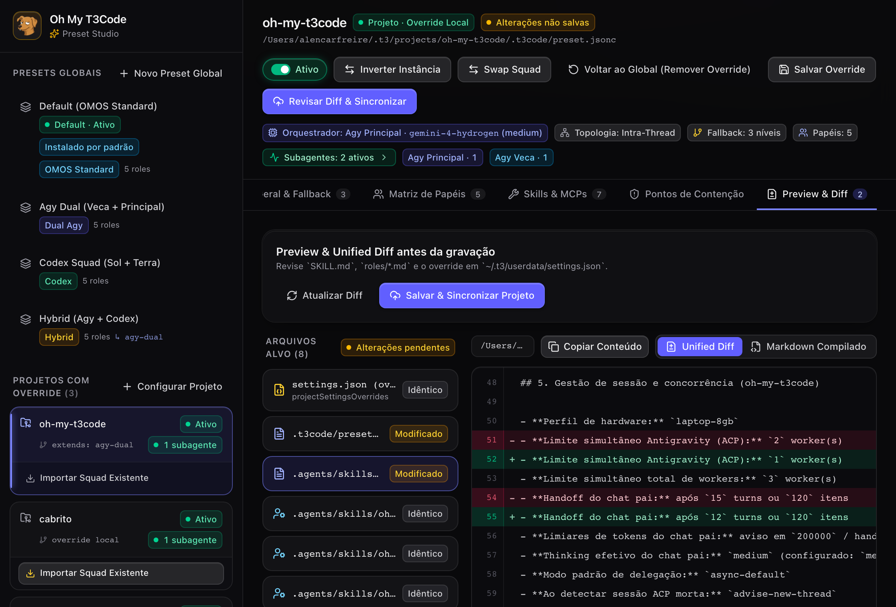

# Complete user guide: Menu Bar Popover & Preset Studio

🌐 **English** | [Português (Brasil)](../GUIA_DE_USO.md) · [Back to README](../../README.md)

This guide walks through every screen, button, keyboard shortcut, and workflow in **Oh My T3Code** across both the **Menu Bar Popover** (`380×500px`) and the **Preset Studio** (`1120×760px`). The current app interface uses Portuguese (Brazil) labels, so this guide keeps each exact UI label alongside its English meaning.

## 1. Menu Bar Popover (`380×500px`)

The **Popover** is your macOS menu bar control center for switching the global preset, managing per-project overrides, and swapping accounts or models in one click.

### Accessing the popover and keyboard shortcuts

In native macOS mode (`bun run tauri:dev` or the compiled app), `oh-my-t3code` runs as a menu bar accessory with no Dock icon:

- **Left-click the menu bar icon**: opens or closes the **Popover** aligned below the icon
- **Right-click the menu bar icon**: opens the native context menu with **`Alternar Popover`** (Toggle Popover), **`Abrir Preset Studio`** (Open Preset Studio), and **`Sair`** (Quit)
- **Click outside the window**: hides the **Popover** automatically when it loses focus

While the **Popover** has focus, use these keyboard shortcuts:

| Shortcut | Action |
| :--- | :--- |
| `⌘K` / `Ctrl+K` or `/` | Focuses the filter input for projects with overrides (shown when 2 or more overrides exist) |
| `⌘,` / `Ctrl+,` | Hides the Popover and opens the **Preset Studio** |
| `Esc` | Closes the **Popover** |

> [!NOTE]
> Pressing `/` focuses the search input only when your cursor is outside an `input`, `textarea`, or `select` field.

### Header and `Preset Global (Default)` section

The top header displays the live status summary (`Global Ativo` when active, or `Global Pausado · N override(s) · M presets` when paused), the refresh button (**`Atualizar dados do T3 Code`**), and the **Studio** button (`⌘,`).

Directly below the header sits the **`Preset Global (Default)`** card, which controls the default configuration applied to every project without a local override:

- **Status badges**: **`Global Ativo`** (Active) / **`Global Pausado`** (Paused) in the header, and **`Instalado por padrão`** (blue badge shown when the active preset is `default`)
- **Toggle `Ativo` / `Desativado`**: enables or pauses the Global Preset. When active, it displays `Padrão para todos os projetos · <model>` and syncs `defaultModelSelection` and `fallbackModelSelection` to `~/.t3/userdata/settings.json`. When disabled, it displays `Desativado — projetos sem override usam config padrão do T3 Code`
- **`Preset Global Default` dropdown**: selects which global preset in `~/.config/oh-my-t3code/presets/*.jsonc` acts as the default (`default` or custom global presets you create)
- **Swap `⇄` button**: switches between configured provider instances/accounts or models in T3 Code in one click when rate limits hit:
  - When primary and secondary instances of the same provider are configured (such as `antigravity` ⇄ `antigravity_2`): displays the active instance label and swaps between both configured instances (`Inverter instância global`)
  - On Codex presets (`codex`): displays `Codex · <model>` and toggles between configured models (such as `gpt-6.1-sol` ⇄ `gpt-6.1-terra`)
  - On other providers (`claudeAgent`, `opencode`, `grok`): displays a pill with the configured instance name
- **Settings icon (`Editar Preset Global no Studio`)**: opens the **Preset Studio** directly on the active Global Preset

### `Saúde global da sessão e RAM` strip (Global Session Health & RAM)

Directly below the header (and below the active subagents strip whenever workers are running), the **Popover** renders the **`Saúde global da sessão e RAM`** strip (`aria-label="Saúde global da sessão e RAM"`) to monitor memory pressure and concurrency in real time:

- **Global status badge**: displays the aggregated session health state (**`OK`** in green, **`Pai gordo`** in amber, **`ACP morto`** in red, or **`Muitos workers`** in red).
- **Concurrency counter**: displays `Agy X/Y · Z/W workers`, comparing active Antigravity workers (`X`) and total active workers (`Z`) against the configured ceilings (`Y` and `W`).
- **`hardwareProfile` chip**: shows the active hardware profile from the Global Preset's `sessionPolicy` (such as `laptop-8gb`, `desktop-16gb`, or `desktop-32gb-plus`).
- **Explicit `Alerta de RAM (8 GB)` banner**: whenever the safe limit for concurrent Antigravity workers or RAM on the active profile is exceeded, the strip highlights a red alert banner prefixed with `Alerta de RAM (8 GB):` and the corresponding containment advisory.

  
   
  <em>Popover overview: session health and RAM strip (<code>OK</code>, <code>Agy 2/2 · 2/3 workers</code>, <code>laptop-8gb</code>), <code>Preset Global (Default)</code> card with swap controls, and <code>Projetos com Override</code>.</em>

### `Projetos com Override` section

T3 Code projects without customizations stay hidden from the main list because they inherit **`Preset Global (Default)`** automatically. Only projects with a local override, a detected squad, or an existing `settings.json` divergence appear under **`Projetos com Override (N)`** (Projects with Override).

To add an override to a project that currently follows the Global Default:

1. Click **`+ Configurar Projeto`** (Configure Project) in the section header.
2. Under **`Projeto do T3 Code (seguindo Global Default)`**, select the target repository.
3. Under **`Preset de Override`**, pick the starting preset to base the override on.
4. Click **`Aplicar Override`** (Apply Override), or **`Cancelar`** (Cancel) to abort.

When **2 or more** projects have overrides, the **`Filtrar projetos, overrides ou instância…`** (`⌘K`) filter bar appears automatically. It matches project title, path (`workspaceRoot`), local preset `id` or `extends`, detected squad slug, and configured instance name (such as `antigravity`, `antigravity_2`, `Codex`, etc.).

Each card in **`Projetos com Override`** displays status badges, session health telemetry, and dedicated actions:

- **Project sync and health badges**:
  - **Session health**: shown next to the project title with states **`OK`** (green), **`Pai gordo`** (amber, when parent thread turns or items exceed budget), **`ACP morto`** (red, when an ACP failure such as `AcpRequestError` occurs), or **`Muitos workers`** (red, when concurrency exceeds the ceiling).
  - **Session summary**: displayed beneath the badges as `Agy X/Y · pai N turns · M itens` when a parent thread has an active warning (`Pai gordo` or `ACP morto`), `Agy X/Y · Z/W workers` when over concurrency, or `Agy X/Y · saudável` when healthy.
  - **`Sincronizado`** (green, Synced): `<repo>/.t3code/preset.jsonc` exists and the override is active
  - **`Squad s/ preset`** (amber, Squad without preset): a manual squad exists at `<repo>/.agents/skills/*-squad/` without `<repo>/.t3code/preset.jsonc`
  - **`Override`** (neutral): an override exists in `settings.json` without a local preset file in `.t3code/`
  - **`Seguindo Global Default (override pausado)`** (amber): shown when the project's individual toggle is set to `Desativado`
- **Health alert and `Abrir thread pai novo` button**:
  - Whenever a project has an alert (`Pai gordo`, `ACP morto`, `Muitos workers`, or `Alerta de RAM (8 GB)`), the card displays a diagnostic box with the **`Abrir thread pai novo`** button (which briefly switches to **`Handoff copiado!`** after clicking).
  - Clicking **`Abrir thread pai novo`** builds and copies a ready-to-use handoff prompt to your clipboard — including the alert reason, affected threads, `sessionPolicy` constraints, and instructions to resume via `ai-memory` (`memory_briefing`, `memory_handoff_accept`, and `memory_query`) — **without writing to `statev2.sqlite` (`SQLite Read-Only`) or creating threads automatically**. Simply open a new parent thread in T3 Code and paste the copied prompt.
- **Card actions**:
  - **Individual toggle (`Ativo` / `Desativado`)**: pauses or reactivates the project override without deleting `.t3code/preset.jsonc`. Pausing removes `projectSettingsOverrides[projectId]` from `settings.json`
  - **One-click Swap `⇄`**: toggles between configured instances of the same provider (e.g. `antigravity` ⇄ `antigravity_2`) or between configured models on `codex` (e.g. `gpt-6.1-sol` ⇄ `gpt-6.1-terra`), recompiles the squad, and updates `settings.json`
  - **`Global` button**: removes the override (`.t3code/preset.jsonc` and `projectSettingsOverrides[projectId]`) and returns the project to the **Global Default**
  - **Preset dropdown + `Sync` button**: applies the chosen preset to the project (displays `Sync…` while writing and `Sincronizado!` when complete)
  - **Settings icon (`Editar no Preset Studio`)**: opens the **Preset Studio** directly on the selected project

### Footer and subagent activity note

Below the global preset and overrides sections, the **Popover** renders the collapsible **`Monitor de Subagentes`** panel (collapsed by default, with an **`N ativo`** / **`N ativos`** badge), fed in strictly read-only mode from `~/.t3/userdata/statev2.sqlite` (`orchestration_v2_projection_subagents`, exposed via `activeSubagentCount` and `subagents` on `DashboardSnapshot`). Expanding the panel lists active and recent subagents with role (`worker` by default), linked project, title, provider/instance, model, status, and relative time—or `Nenhum subagente ativo ou recente.` when none exist.

  
   
  <em>Expanded <code>Monitor de Subagentes</code> panel showing active (<code>Agy Principal</code>, <code>Agy Veca</code>) and recent (<code>Codex</code>) workers read in read-only mode from <code>statev2.sqlite</code>.</em>

The **Popover** footer confirms the safety guarantees with the **`SQLite Read-Only · ~/.t3`** badge and the **`Esc para fechar`** (Esc to close) reminder.

## 2. Preset Studio (`1120×760px`)

The **Preset Studio** is the full editor for creating global presets, inheriting configurations with `extends`, building the role matrix, attaching skills and MCPs, defining contention policies, and inspecting the **Unified Diff** before writing to disk.

Closing the **Preset Studio** window hides it rather than quitting, keeping the companion resident in the macOS menu bar.

### Left sidebar (`StudioSidebar`)

The left sidebar splits navigation into two groups:

1. **`Presets Globais`** (Global Presets):
   - Lists every preset in `~/.config/oh-my-t3code/presets/*.jsonc` with badges such as **`Default · Ativo`**, **`Default · Pausado`**, **`Desativado`**, **`Instalado por padrão`**, preset family (`OMOS Standard`, `Codex`, `Custom`, etc.), role count (`N roles`), and inheritance (`↳ <parent>`)
   - Click **`+ Novo Preset Global`** (New Global Preset) to open the creation form: enter **`ID do Preset (~/.config/.../presets/*.jsonc)`** (letters, numbers, `-`, or `_`) and choose **`Nenhum (Base)`** (None / Base) under **`Herdar de (extends)`** to start from scratch, or pick an existing preset to clone and extend its settings
2. **`Projetos com Override`** (Projects with Override):
   - Lists only projects that have an override or a detected squad, displaying the **`Ativo`** / **`Desativado`** badge and inheritance reference (`extends: ...`, `preset: ...`, or `override local`)
   - Click **`+ Configurar Projeto`** to convert a project following the Global Default into a local override (or import its squad directly using **`Importar Squad`** when present)
   - **Reverse Importer (`Importar Squad Existente`)**: whenever the backend detects an `.agents/skills/*-squad/` directory in a repository, the card shows **`Importar Squad Existente`** (Import Existing Squad). Clicking it reads the existing `SKILL.md` and `roles/*.md` files and converts the manual squad into `<repo>/.t3code/preset.jsonc`

### Editor header and architecture summary strip

The top bar adapts its badges and actions based on the item selected in the sidebar:

- **Global Mode**:
  - Displays the **`Preset Global`** badge (plus **`Default Global`** and **`Instalado por padrão`** when applicable) and the file path `~/.config/oh-my-t3code/presets/<id>.jsonc`
  - Actions: **`StatusToggle`** (`Ativo` / `Desativado`), **`Definir como Global Default`** (Set as Global Default, shown when the selected preset is not the active global default), and **`Salvar Preset Global`** (Save Global Preset)
- **Project Mode**:
  - Displays the **`Projeto · Override Local`** badge and the file path `<repo>/.t3code/preset.jsonc`
  - Actions: **`StatusToggle`** (`Ativo` / `Desativado`), **`Voltar ao Global (Remover Override)`** (Return to Global / Remove Override), **`Salvar Override`** (Save Override), and **`Revisar Diff & Sincronizar`** (Review Diff & Sync, which jumps straight to the **`Preview & Diff`** tab)
- **`Alterações não salvas` badge**: appears in amber whenever the current draft differs from the file saved on disk
- **Architecture summary strip**: shows **`Orquestrador`** (Orchestrator), **`Topologia`** (`Intra-Thread` or `Issue-Thread`), **`Fallback: N nível(is)`**, and **`Papéis: N`** (Roles) at a glance

### Navigating the 5 editor tabs

The tab bar (**`Seções do Editor`**) supports keyboard navigation with `ArrowLeft` and `ArrowRight` across the 5 panels below.

#### Tab 1: `Visão Geral & Fallback` (Overview & Fallback)

Centralizes preset metadata, inheritance, primary orchestrator routing, and the fallback chain:

- **Identity, Inheritance (`extends`) & Topology**:
  - **`Nome do Preset`**: display name shown in the sidebar and selectors
  - **`Identificador (id)`**: read-only field matching the `.jsonc` filename
  - **`Herda de (extends)`**: choose **`Nenhum (Base)`** or any parent Global Preset to inherit roles, fallback chain, and contention rules
  - **`Topologia da Squad`**: choose between `intra-thread-squad (Workers via delegate_task)` for workers inside the same thread and `issue-thread-orchestrator (Orquestração por threads/issues)` for independent threads per issue or worktree
  - **`Descrição`**: short summary of the preset's purpose
- **Primary Orchestrator (`settings.json` Override)**:
  - Uses the `ModelRoutingFields` component to define `defaultModelSelection` written to T3 Code:
  - **`Instância (providerInstanceId)`**: full dropdown plus one-click chips for the provider instances configured in your T3 Code setup (such as primary and secondary `antigravity` / `antigravity_2`, `Codex`, etc.)
  - **`Modelo (model)`**: dropdown plus fast chips for known models, and a **`Custom`** button that switches to a free-text input (click **`Usar lista`** to switch back to the dropdown)
  - **`Opções do Orquestrador (1-clique)`**: provider-specific quick pills:
    - Antigravity (`antigravity`, `antigravity_2`): `thinking_level` (`low`, `medium`, `high`, `xhigh`)
    - Codex (`codex`): `reasoningEffort` (`low`, `medium`, `high`, `xhigh`) and `serviceTier` (`default`, `priority`)
  - **`Avançado`**: expands the key/value editor (**`Parâmetros personalizados (key / value)`**) to add or adjust extra options; the button label switches to **`Ocultar chave/valor`** when open
- **Visual Fallback Pipeline (`fallbackChain`)**:
  - Connects the origin node (**`Orquestrador Primário`**) to each numbered fallback step (`Nível 1`, `Nível 2`, …)
  - Click **`Adicionar Passo`** (Add Step) to append a new fallback level
  - On each step, use the arrow buttons to move priority up or down, the trash icon to remove it, the **`Instância`**, **`Modelo`**, and **`Opções do Nível`** controls, and **`Motivo / Regra de Acionamento`** to document when the squad should trigger that fallback

#### Tab 2: `Matriz de Papéis` (Role Matrix)

Configures each specialized worker compiled into `<repo>/.agents/skills/<slug>-squad/roles/<id>.md`:

- **Left column (`Papéis (roles/)`)**:
  - Lists all roles alphabetically with model, instance, primary option, and counts for skills, MCPs, and verification checks
  - Click **`+ Adicionar Papel`** (Add Role) to create a custom ID (`[a-z0-9_-]`) or pick one of the **11 pre-configured quick templates**: `explorer`, `oracle`, `designer`, `fixer`, `qa-reviewer`, `backend`, `frontend`, `rust-core`, `crystal`, `meta-sync`, and `delivery-manager`
- **Right column (4 cards for the selected role)**:
  1. **`Identidade (roles/<id>.md)`**: edit **`Título do Papel`** (Role Title), **`Quando Acionar (whenToUse)`** (When to Use), and **`Descrição do Papel`** (Role Description), or click **`Remover Papel`** (Remove Role)
  2. **`Roteamento de Modelo & Instância`**: assign an instance, model, and options (`thinking_level` / `reasoningEffort`) specific to this role without changing the orchestrator
  3. **`Escopo de Arquivos`**: add glob patterns or directories to **`Caminhos Permitidos (allowedPaths)`** (green chips) and **`Caminhos Proibidos (forbiddenPaths)`** (red chips) to prevent parallel edit conflicts
  4. **`Invariantes & Verificação`**: list mandatory rules under **`Invariantes do Papel (invariants)`** and quality-gate commands under **`Comandos de Verificação (verificationCommands)`** (rendered in terminal format `$ ...`, such as `cargo test --manifest-path src-tauri/Cargo.toml` and `bun run typecheck`)

*`Matriz de Papéis` (Role Matrix) tab: sidebar listing `Presets Globais` and `Projetos com Override`, role list (`roles/`), and per-role model/instance routing.*

#### Tab 3: `Skills & MCPs`

Optionally attaches local skills and Model Context Protocol (MCP) servers configured in your environment to each role in the squad:

- **Top selector (`Papel:`)**: switch between roles in the preset without leaving the tab
- **`Skills Globais`**:
  - Default directories scanned for local skills: `~/.config/skillshare/skills` and `~/.gemini/config/skills` (optional; if these directories do not exist in your environment, you can still create and manage presets without local skills)
  - Switch between **`Todas`** (All) and **`Apenas Selecionadas`** (Selected Only), search by name or description in **`Buscar skill (ex: tailwind, tdd, security)…`**, and filter by source (**`Todas origens`** or any detected source directory)
  - Check or uncheck the skills you want to attach; enabled items display the **`Ativa`** badge
- **`MCPs Recomendados`**:
  - All MCP servers are optional and configurable based on your environment. Studio provides quick toggles for common optional MCP servers if they are part of your setup:
    - **`ai-memory`** (`Memória & Handoffs`): durable project memory, architecture decisions, and cross-session handoffs
    - **`context7`** (`Docs Atualizadas`): up-to-date library and framework documentation (Tauri, React, Tailwind)
    - **`playwright`** (`E2E & Visual`): browser automation, accessibility snapshots, and visual E2E testing
    - **`linear`** (`Issues & Status`): optional integration for reading and updating issues, projects, cycles, and statuses in Linear
  - Use **`Adicionar MCP customizado`** (button **`Add`**) to attach any other MCP server configured in your environment (tagged with the `custom` badge)

#### Tab 4: `Pontos de Contenção` (Contention Points)

This tab groups two stacked sections — first **`Sessão e hardware (sessionPolicy)`** (Session & Hardware) and, directly below it, **`Política de Contenção & Isolamento (contention)`** (Contention & Isolation Policy) — both compiled into the squad's `SKILL.md` to prevent parallel worker collisions, RAM pressure, and unstable ACP sessions:

**1. `Sessão e hardware (sessionPolicy)`**:

- **`Aplicar limites sugeridos (N Agy)` button**: automatically fills `Máx. Workers Antigravity` (`2` for `laptop-8gb`, `3` for `desktop-16gb`, `4` for `desktop-32gb-plus`), `Máx. Total de Workers` (`N + 1`), and resets `parentThinkingLevel` to `medium` when `laptop-8gb` is selected.
- **`Perfil de Hardware (hardwareProfile)`**: choose `laptop-8gb — Laptop 8 GB (máx. 2 Antigravity, pai medium)`, `desktop-16gb — Desktop 16 GB (máx. 3 Antigravity)`, or `desktop-32gb-plus — Workstation 32+ GB (máx. 4 Antigravity)`.
- **`Thinking do Thread Pai (parentThinkingLevel)`**: choose between `low`, `medium`, `high`, and `xhigh`. When `laptop-8gb` is active and you select `high` or `xhigh`, the UI shows an amber downgrade note: **`Nota laptop-8gb: o compilador rebaixa automaticamente o thinking efetivo do thread pai para medium (em vez de high/xhigh) para evitar saturação de RAM.`** (explaining that the compiler clamps the parent's effective thinking level to `medium` to avoid RAM saturation).
- **Numeric concurrency and parent-budget limits**:
  - **`Máx. Workers Antigravity`** (`maxConcurrentAntigravityWorkers`): simultaneous Agy instance limit before triggering an alert.
  - **`Máx. Total de Workers`** (`maxConcurrentWorkersTotal`): maximum total parallel workers per project.
  - **`Máx. Turns do Pai (Handoff)`** (`parentMaxTurnsBeforeHandoff`): above this threshold the parent thread is flagged as `Pai gordo`.
  - **`Máx. Itens do Pai (Handoff)`** (`parentMaxItemsBeforeHandoff`): accumulated items before suggesting a new parent thread.
  - **`Alerta de Input Tokens`** (`parentWarnInputTokens`): warning threshold in the orchestrator context (step `1000`).
  - **`Limite Rígido de Input Tokens`** (`parentHardInputTokens`): hard ceiling before requiring a session handoff (step `1000`).
- **`Modo de Delegação (delegateMode)`**: choose `async-default — Delegação assíncrona padrão (sem polling)`, `sync-only — Apenas tarefas síncronas curtas`, or `adaptive — Adapta conforme carga e perfil de hardware`.
- **`Recuperação ACP Morto (onAcpSessionDead)`**: choose `advise-new-thread — Instruir handoff imediato em novo thread pai`, `fallback-codex — Transbordar worker para Codex quando possível`, or `halt — Interromper novas delegações até diagnóstico`.
- **`Thinking & Modelo por Tipo de Worker (workerThinkingByKind)` editor**: defines the model and `thinkingLevel` (`low`, `medium`, `high`, `xhigh`) per task kind (such as `architecture`, `backend`, `frontend`, `qa`, and `research`), lets you delete entries, or add new kinds via **`Novo tipo (ex: security)`** + **`Adicionar tipo`**.
- **`Padrões Proibidos (forbiddenPatterns)`**: red chip list editor for negative rules compiled into `SKILL.md` (e.g., `thinking high no pai`, `continuar thread após provider_error AcpRequestError`).

*`Pontos de Contenção` (`sessionPolicy`) tab: configure `hardwareProfile`, `parentThinkingLevel`, Antigravity/total worker caps, and parent handoff budgets.*

**2. `Política de Contenção & Isolamento (contention)`**:

- **`Banco de Testes Único (singleTestDb)`**: when checked, instructs the squad to serialize test suites (such as RSpec or SQLite) to avoid database locks between parallel workers
- **`Isolamento Padrão (defaultIsolation)`**: choose `shared — Ondas sequenciais no mesmo workspace` (sequential waves in the same workspace) or `worktree — Git worktrees isolados para frentes paralelas` (isolated Git worktrees for parallel tracks)
- **`Variáveis de Ambiente Obrigatórias (envVars)`**: required key/value pairs such as `PARALLEL_WORKERS=1`
- **`Artefatos de Build Fora do Git (gitIgnoredBuilds)`**: untracked build directories such as `target/`, `dist/`, and `tmp/`
- **`Arquivos de Alta Contenção (conflictFiles)`**: shared manifests or lock-prone files (red chips, such as `package.json`, `Cargo.toml`, `tauri.conf.json`, and `db/schema.rb`) that workers must not edit concurrently

#### Tab 5: `Preview & Diff`

Generates and displays the deterministic compilation output before anything is written to disk:

- **`Simular no projeto`** (visible in Global Mode): select any T3 Code project to preview how the Global Preset would compile in that repository
- **`Atualizar Diff` button**: recalculates the deterministic preview (`SKILL.md`, `roles/*.md`, `.t3code/preset.jsonc`, and `settings.json`). Edits made to `sessionPolicy` in the **`Pontos de Contenção`** tab update Section **`## 5. Gestão de sessão e concorrência (oh-my-t3code)`** of `SKILL.md` (and any `laptop-8gb` `thinking_level` clamp in `settings.json`) in real time before saving
- **`Arquivos Alvo` list**:
  - Shows `settings.json (override)` (`projectSettingsOverrides`), followed by `.t3code/preset.jsonc`, `.agents/skills/<slug>-squad/SKILL.md`, and each `roles/<id>.md`
  - Each entry receives a status badge (**`Novo`** in green, **`Modificado`** in amber, or **`Idêntico`** in neutral), alongside the global **`Alterações pendentes`** or **`Em dia`** badge
- **Right-hand viewer**:
  - Displays the full path of the selected file, the **`Copiar Conteúdo`** button (changes to **`Copiado`** after copying), and the view switcher between **`Unified Diff`** and **`Markdown Compilado`**
- **Saving**:
  - In Global Mode, click **`Salvar Preset Global`** to save `~/.config/oh-my-t3code/presets/<id>.jsonc`
  - To save and sync to the selected project, click **`Salvar & Sincronizar Projeto`**: the backend creates `settings.json.bak`, updates `settings.json` atomically, and writes only modified files to the repository

*`Preview & Diff` tab: `Unified Diff` view highlighting changes to Section 5 of `SKILL.md` (`Gestão de sessão e concorrência`) before writing to disk.*

## 3. Recommended daily workflows

These five workflows cover the most common tasks when operating multiple accounts, session limits, and repositories in T3 Code.

### Scenario 1: Initial setup with T3 Code

1. Launch `oh-my-t3code` (`bun run tauri:dev` or the installed app) to initialize the default `default` preset in `~/.config/oh-my-t3code/presets/`.
2. Click the menu bar icon to open the **Popover**.
3. Under **`Preset Global (Default)`**, keep `default` or select a custom global preset you created in Preset Studio (`+ Novo Preset Global`) with your preferred providers and models, and verify the toggle is set to **`Ativo`**.
4. From that point on, every project without a local override follows this global default in `~/.t3/userdata/settings.json`.

### Scenario 2: Project with an existing manual squad (`.agents/skills/*-squad/`)

1. Open **Preset Studio** (`⌘,`).
2. In the left sidebar, locate the project marked with a detected squad (or click **`+ Configurar Projeto`** if it is not yet in the override list) and click **`Importar Squad Existente`**.
3. The **Reverse Importer** extracts roles, models, skills, MCPs, file scopes, and verification commands into `<repo>/.t3code/preset.jsonc`.
4. Refine roles, `extends`, or contention rules across the Studio tabs.
5. Open the **`Preview & Diff`** tab, inspect the **Unified Diff** for `SKILL.md`, `roles/*.md`, and `settings.json`, and click **`Salvar & Sincronizar Projeto`**.

### Scenario 3: Hitting a rate limit or quota mid-session

1. Left-click the menu bar icon to open the **Popover**.
2. If the session belongs to a project with its own override, click the **`⇄`** pill directly on that project's card to switch between configured instances of the same provider (such as `antigravity` ⇄ `antigravity_2`) or between configured models (such as `Codex · gpt-6.1-sol` ⇄ `gpt-6.1-terra`).
3. If the project follows the global default, click the **`⇄`** pill inside the **`Preset Global (Default)`** card.
4. Within seconds, the backend backs up `settings.json` to `.bak`, updates it atomically, and routes the project's squad to the alternate instance or model.

### Scenario 4: Testing preset changes safely in Browser Preview

1. From the project root, run `bun run dev` to start the frontend on port `1420` with `MockIpcStore` enabled (no real files under `~/.t3` or `~/.config/oh-my-t3code` are touched).
2. Open `http://localhost:1420` in your browser, or jump straight to `http://localhost:1420/?view=studio` and `http://localhost:1420/?view=popover`.
3. Experiment with new presets using `extends`, configure `fallbackChain`, test filters, and inspect the generated **Unified Diff** using the in-memory sample projects.
4. Once satisfied with the configuration, apply it in the native app (`bun run tauri:dev`).

### Scenario 5: Recovering a session after `Pai gordo`, `ACP morto` (`AcpRequestError`), or `Alerta de RAM (8 GB)`

1. Open the **Popover** and check the **`Saúde global da sessão e RAM`** strip (`Agy X/Y · Z/W workers`) as well as the affected project card (`Pai gordo`, `ACP morto`, or `Muitos workers`, along with `Agy X/Y · pai N turns · M itens`).
2. If **`Alerta de RAM (8 GB)`** or over-concurrency is active, wait for running subagents to settle before launching new waves (or adjust `sessionPolicy` under **`Pontos de Contenção`** in **Preset Studio**).
3. Inside the project's alert box in the **Popover**, click **`Abrir thread pai novo`** (the button confirms **`Handoff copiado!`**). This only copies the structured handoff prompt to the clipboard — it does not write to `statev2.sqlite` or create threads automatically.
4. In **T3 Code**, open a **clean new parent thread** in the same repository and paste the copied prompt.
5. The new orchestrator thread automatically follows the prompt steps: it reads `AGENTS.md`, `README.md`, and `.agents/skills/<slug>-squad/SKILL.md`, restores consolidated context via `ai-memory` (`memory_briefing`, `memory_handoff_accept`, `memory_query`), checks `git status --short` / `git diff --stat`, and resumes work within `sessionPolicy` limits.
